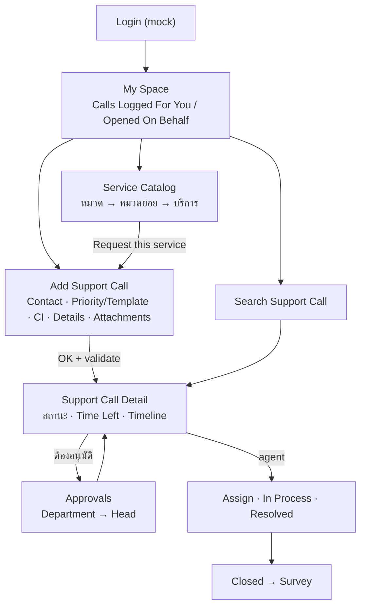

# IT-01: ITSM Support Desk — ระบบแจ้งเรื่องและติดตาม Support Call (ร่าง)

> **สถานะ:** DRAFT สำหรับเข้า aidlc (`/aidlc start` → aidlc-requirements) · ยังไม่ได้วางลง `initial-requirements/` ของ repo
>
> **ป้ายกำกับที่มาของข้อมูล (ใช้ทั้งเอกสาร):**
> - `[OBS]` = เห็นจริงในระบบ ITSM ที่ใช้งานอยู่ (สำรวจแบบอ่านอย่างเดียว 2026-11-11) — คัดเฉพาะ**โครงสร้าง** (ชื่อ field, ตัวเลือก, หน้า) ไม่มีข้อมูลจริง
> - `[PROP]` = ข้อเสนอเพื่อให้ระบบใหม่ใช้งานได้ครบ
> - `[ASM]` = สมมติฐาน ยังไม่ยืนยัน (ต้องให้ BA/เจ้าของระบบยืนยัน)
>
> ⚠️ **DISCLAIMER:** ชื่อคน, อีเมล, เลข ticket, หมวด service, ชื่อหน่วยงานในเอกสารนี้และใน `database.json` เป็น **ตัวอย่างสมมติ** ไม่ใช่ข้อมูลจริงขององค์กร

## เอกสารข้อกำหนดระบบ (Requirement Specification) — AI-DLC Workshop

| รายการ | รายละเอียด |
|--------|-----------|
| รหัสแอป | IT-01 |
| ชื่อฟีเจอร์ | ITSM Support Desk — แจ้งเรื่อง (Incident / Service Request / RFC), ติดตามสถานะ, อนุมัติ, ค้นหา |
| ประเภท | Web Application (รันบน Local) `[ASM]` |
| ลูกค้า | ฝ่าย IT ภายในองค์กร (ตัวอย่าง) |
| กลุ่มผู้ใช้ | พนักงานผู้แจ้ง (Requestor), หัวหน้า/ผู้อนุมัติ, เจ้าหน้าที่ Service Desk / Resolver, Admin `[ASM]` |
| ข้อมูลอ้างอิง | `database.json` (users, groups, services, templates, calls, activities, approvals — ข้อมูลตัวอย่าง) |
| มาตรฐาน | AI-DLC Spec-Driven, EARS Notation, WCAG 2.2 AA, ITIL v3/v4 (คำศัพท์) |

### Open Decisions (ค่า default ที่ใช้ในร่างนี้ — แก้ได้ก่อนเข้า aidlc)

| # | เรื่อง | Default ในร่าง |
|---|---|---|
| OD-1 | Tech stack | **ยืนยันแล้ว: React + Vite** · ส่วนประกอบอื่น (TypeScript, Tailwind, Local JSON + localStorage, ไม่มี backend) ยังเป็น default `[ASM]` |
| OD-2 | Call type ที่อยู่ใน scope | **ยืนยันแล้ว:** Must: Incident, Service Request · Should: RFC (+ approval) · Nice: Problem, Request Fulfilment (ITSR) |
| OD-3 | Approval flow | **ยืนยันแล้ว:** Should — 2 ระดับ Department → Head · CAB = Nice |
| OD-4 | AI | **ยืนยันแล้ว: ใช้ agent บน Azure** (แทน Finions ทั้งหมด) · หน้าที่: ช่วยเปิด ticket + navigate ผู้ใช้ไปหน้าต่าง ๆ (§5.12) · endpoint / auth / request-response / error รอระบุ `[TBD]` |
| OD-5 | Roles | **ยืนยันแล้ว:** 4 role ตาม §5.11 (requestor / approver / agent / admin) — สิทธิ์ละเอียดยังเป็นสมมติฐาน |

---

## 1. บทนำ (Introduction)

### 1.1 ภาพรวมฟีเจอร์
ระบบให้พนักงานแจ้งปัญหา IT/อาคาร ขอใช้บริการ และขอเปลี่ยนแปลงระบบ (RFC) ผ่านหน้าเว็บเดียว เลือกบริการจาก Service Catalog แบบลำดับชั้น หรือกรอกฟอร์ม Support Call ตรง ระบบให้เลข ticket, จัดลำดับความสำคัญจาก Urgency × Impact, ส่งเข้าคิวกลุ่มผู้รับผิดชอบ, ส่งขออนุมัติเมื่อจำเป็น และให้ผู้แจ้งติดตามสถานะ/เวลาที่เหลือตาม SLA ได้จาก My Space

### 1.2 ระบบและข้อมูลที่เกี่ยวข้อง
- `database.json` — ข้อมูลตัวอย่างทั้งหมด (ไม่มีข้อมูลจริง)
- Design system ของโครงการใหม่ (ห้ามลอก UI/แบรนด์ของระบบเดิม) `[PROP]`

### 1.3 ขอบเขตระบบ (Scope)
**In Scope:** Service Catalog, ฟอร์มแจ้งเรื่อง, My Space, ค้นหา Support Call, หน้ารายละเอียด/ติดตาม, อนุมัติ, Knowledge Base (Answers) แบบค้นหา, role/permission
**Out of Scope:** การเชื่อม AD/SSO จริง, อีเมลแจ้งเตือนจริง, Asset/CMDB เต็มรูป (Products, RMA, Service Agreements — เห็นในระบบเดิมแต่ตัดไว้ Future) `[PROP]`

### 1.4 คำจำกัดความ (Glossary)

| คำศัพท์ | ความหมาย |
|---|---|
| Support Call | ticket 1 รายการ (ทุก call type) `[OBS]` |
| Call Type | Incident / Problem / Change (RFC) / Request Fulfilment (ITSR) / Service Requests `[OBS]` |
| Classification | หมวดย่อยเชิงประเภท เช่น "Service Request" หรือ n/a `[OBS]` |
| Template | แม่แบบ call ที่กำหนด call type/หมวด/คิวล่วงหน้า (ผูกกับรายการใน Catalog) `[OBS]` + `[ASM]` |
| Service Catalog | ต้นไม้หมวดบริการ → รายการบริการ → "Request this service" `[OBS]` |
| Urgency / Impact | ระดับความเร่งด่วน / ผลกระทบ (มีชุดแยกสำหรับ RFC) `[OBS]` |
| Priority | ผลจาก Urgency × Impact `[ASM]` |
| Queue / Group | คิว/กลุ่มเจ้าหน้าที่ที่รับเรื่อง `[OBS]` |
| Time Left | เวลาที่เหลือก่อน Due Date (ติดลบ = เลยกำหนด) `[OBS]` |
| CI | Configuration Item: Service, Product, Item, Serial number, Version `[OBS]` |
| On behalf | แจ้งแทนผู้อื่น ("Somebody else") `[OBS]` |
| VVIP | ธงผู้แจ้งสำคัญ (true/false) `[OBS]` |

---

## 2. รายละเอียดภาพรวม

### 2.1 มุมมองผลิตภัณฑ์
Web app เดี่ยว · ข้อมูลตั้งต้นจาก `database.json` · persist ใน localStorage `[ASM]`

### 2.2 กลุ่มผู้ใช้งาน
| Role | ทำอะไร | ที่มา |
|---|---|---|
| `requestor` | แจ้งเรื่องให้ตัวเอง/แจ้งแทน, ติดตาม, ยกเลิกเรื่องของตัวเอง, ทำแบบสอบถามหลังปิด | `[OBS]` (มุมที่สำรวจ) |
| `approver` | อนุมัติ/ปฏิเสธ Department หรือ Head approval | `[OBS]` มีหน้า Approvals + checkbox "My Approvals" · สิทธิ์ละเอียด `[ASM]` |
| `agent` | รับเรื่องในคิว, assign, เปลี่ยนสถานะ, บันทึก activity, ปิดเรื่อง | `[ASM]` (เห็นคอลัมน์ Assigned To/Queue แต่ไม่เห็นหน้าฝั่ง agent) |
| `admin` | จัดการ catalog, template, กลุ่ม, ผู้ใช้ | `[ASM]` |

### 2.3 สมมติฐานและข้อจำกัด
- Login เป็น mock (ระบบเดิมใช้ SSO ขององค์กร) `[ASM]`
- ไม่มีข้อมูลจริง ไม่เรียกระบบเดิมผ่าน network `[PROP]`

---

## 3. เทคโนโลยีที่ใช้ (Tech Stack) — OD-1

| ส่วน | เทคโนโลยี |
|---|---|
| Frontend | **React + Vite** (ยืนยันแล้ว) · TypeScript + Tailwind + Lucide `[ASM]` |
| ข้อมูล | `database.json` + localStorage |
| Logic | TypeScript pure functions: priority, SLA/due date, state machine |
| Rich text | editor สำหรับ Notes (ระบบเดิมมี toolbar: bold/italic/underline/list/font/table) `[OBS]` |

---

## 4. โครงสร้างข้อมูลและตรรกะระบบ

### 4.1 Data Entities
> field ที่มาจากฟอร์ม/คอลัมน์ระบบเดิม = `[OBS]` · id/format = `[PROP]`

**SupportCall** — `id`, `number` (ตัวเลข 6 หลัก `[OBS]`), `callType`, `classification`, `parentCategory`/`category`/`subCategory` `[OBS]`, `templateId`, `requestorId`, `openedByUserId` (แจ้งแทน) `[OBS]`, `phone`, `email`, `customerReference` ("Your reference no.") `[OBS]`, `urgency`, `impact`, `priority`, `serviceId`, `productId`, `itemId`, `serialNumber`, `version` `[OBS]`, `summary` (บังคับ) `[OBS]`, `notes` (rich text, บังคับ) `[OBS]`, `status`, `queueId`, `groupId`, `assignedToId`, `organization`, `location` `[OBS]`, `openDate`, `dueDate`, `closeDate` `[OBS]`, `closureCategory` `[OBS]`, `itsrReference` `[OBS]`, `vvip` `[OBS]`, `surveyResult`, `feedbackCategory` `[OBS]`, `attachments[]` `[OBS]`
  - เฉพาะ RFC: `scheduledDate`, `implementationStart/End`, `systemDownStart/End`, `cabMeetingStart/End` `[OBS]` (คอลัมน์ใน My Space)

**Activity** (Scheduled Activity / Task) — `id`, `callId`, `taskType`, `subject`, `scheduledStart/End`, `priority`, `status`, `owner`, `actionPlan`, `attachments` `[OBS]` · `type`: CAB Meeting / Change Freeze Window / Deployment Dates / Standard Task / System Down Dates `[OBS]`

**Approval** — `id`, `callId`, `approvalType` (Department approval / Head approval `[OBS]`), `approverId`, `done` (bool `[OBS]`), `decision`, `comment`, `decidedAt` `[PROP]`

**ServiceCategory** — `id`, `parentId`, `name`, `description`, `slaNote` `[OBS]` (ต้นไม้หลายชั้น)

**ServiceDefinition** — `id`, `categoryId`, `name`, `description`, `requestType` (เช่น Incident) `[OBS]`, `templateId` `[ASM]`

**Template** — `id`, `name`, `callType`, `classification`, `category`, `defaultQueueId`, `defaultUrgency`, `defaultImpact`, `requiresApproval[]` `[ASM]`

**AnswerArticle** (Knowledge) — `number`, `summary`, `category`, `book`, `item`, `itemVersion`, `body` `[OBS]` (field ค้นหา)

**User / Group / Organization** — `id`, `name`, `email`, `phone`, `role`, `groupIds[]`, `organization`, `location`, `vvip` `[PROP]`

### 4.2 ค่าตัวเลือก (Enumerations) `[OBS]`

- **Call Type:** Incident · Problem · Change (RFC) · Request Fulfilment (ITSR) · Service Requests
- **Urgency:** 1-Critical · 2-High · 3-Medium · 4-Low · RFC - Major · RFC - Medium · RFC - Minor
- **Impact:** 1-Extensive/Widespread · 2-Significant/Large · 3-Moderate/Limited · 4-Minor/Localized · RFC - Very High · RFC - High · RFC - Medium · RFC - Low · RFC - Very Low
- **Status (รวมทุก call type ในระบบเดิม, 47 ค่า มีซ้ำ):** Saved/Draft, Draft, Unlocked, Returned, Request Submitted, New, Assigned, Re-Assigned, Pending, In Process, Root Cause Identify, Known Error, Waiting for Implementation, Resolution Identify, Monitoring, Resolved, Waiting For Approve, Request For Change, Planning in Progress, Scheduled for Review, Head Rejected, Head Approved, Under Review, Approval Resubmitted, Ready for CAB, Request Cancelled, Completed, Cancelled, Evaluation, Department Accepted, Department Declined, Implementation, Rejected, Failed, Survey Completed, Re-Opened, Request In-Progress, Request Approved, Request Rejected, Request Completed, Delivered, Waiting for return, Closed
  - → `[PROP]` ระบบใหม่แยก status set ตาม call type (ดู §4.4) และ dedupe
- **Open/Closed filter:** All · Open · Closed
- **Activity Type:** CAB Meeting · Change Freeze Window · Deployment Dates · Standard Task · System Down Dates
- **Approval Type:** Department approval · Head approval
- **Requested for:** Myself · Somebody else

### 4.3 Business Logic
**4.3.1 Priority** `[ASM]` — matrix Urgency × Impact → P1–P4 (ระบบเดิมไม่แสดง matrix ให้เห็น) · ตัวอย่าง: U1×I1=P1, U1×I2=P1, U2×I2=P2, U3×I3=P3, ที่เหลือ P4
**4.3.2 Due Date / SLA** `[ASM]` — dueDate = openDate + SLA ตาม priority/หมวด · `timeLeft = dueDate − now` แสดงรูป "X days hh:mm" ติดลบเมื่อเลยกำหนด `[OBS: รูปแบบ]`
**4.3.3 Running number** `[PROP]` — เลข ticket เพิ่มทีละ 1 ไม่ซ้ำ

### 4.4 State Machine (เสนอ) `[ASM]` — ระบบเดิมไม่แสดง transition

- **Incident:** New → Assigned → In Process ⇄ Pending → Resolved → Closed · Resolved → Re-Opened → In Process · ใด ๆ ก่อน Resolved → Cancelled
- **Service Request:** Request Submitted → Waiting For Approve → (Department Accepted|Department Declined) → (Head Approved|Head Rejected) → Request In-Progress → Request Completed → Closed
- **RFC:** Draft → Request For Change → Under Review → Ready for CAB → Scheduled for Review → Implementation → Completed|Failed → Closed
- **Problem (Nice):** New → Root Cause Identify → Known Error → Resolution Identify → Monitoring → Closed

### 4.5 Validation Rules
| Field | Rule | Error Message | ที่มา |
|---|---|---|---|
| Requestor | บังคับ | "กรุณาเลือกผู้แจ้ง" | `[OBS]` บังคับ · ข้อความ `[PROP]` |
| Summary | บังคับ, 1–200 ตัวอักษร | "กรุณากรอกหัวข้อเรื่อง" | `[OBS]` บังคับ · ความยาว `[PROP]` |
| Notes | บังคับ (ไม่ว่างหลังตัด tag) | "กรุณาระบุรายละเอียด" | `[OBS]` บังคับ · ข้อความ `[PROP]` |
| E-mail | รูปแบบอีเมล | "รูปแบบอีเมลไม่ถูกต้อง" | `[PROP]` |
| Phone | ตัวเลข 9–10 หลัก (ถ้ากรอก) | "เบอร์โทรไม่ถูกต้อง" | `[PROP]` (ระบบเดิม default "0") |
| Urgency/Impact | ชุด RFC เลือกได้เฉพาะ call type RFC | "ระดับนี้ใช้กับ RFC เท่านั้น" | `[PROP]` |
| Attachment | ≤ 10MB/ไฟล์, ≤ 5 ไฟล์ | "ไฟล์ใหญ่เกินกำหนด" | `[PROP]` |
| Open date from/to | from ≤ to | "ช่วงวันที่ไม่ถูกต้อง" | `[PROP]` |

> หมายเหตุ: ไม่ได้กด OK ในระบบเดิม จึงไม่เห็น error message จริง — ทุกข้อความเป็นข้อเสนอ

---

## 5. ข้อกำหนดฟังก์ชัน (Functional Requirements)

### 5.1 Page Map
| Page | ชื่อหน้า | อ้างอิงระบบเดิม | FR |
|---|---|---|---|
| P1 | Login (mock) | — | FR-001–002 |
| P2 | My Space | `MYSPACE.aspx` `[OBS]` | FR-010–014 |
| P3 | Service Catalog | `BrowseServiceCatalog.aspx`, `BrowseService.aspx` `[OBS]` | FR-020–025 |
| P4 | Add Support Call (ฟอร์ม) | `SupportCall.aspx?SupportCallMode=Add` `[OBS]` | FR-030–041 |
| P5 | Search Support Call | `SupportCall.aspx` `[OBS]` | FR-050–056 |
| P6 | Support Call Detail / ติดตาม | ไม่ได้เปิดดู `[ASM]` | FR-060–068 |
| P7 | Approvals | `SupportCallCab.aspx` `[OBS]` | FR-070–074 |
| P8 | Scheduled Activities | `SupportCallActivity.aspx` `[OBS]` | FR-080–082 |
| P9 | Answers (Knowledge) | `AnswerBookPage.aspx` `[OBS]` | FR-090–091 |
| Global | Navigation, Roles | `[OBS]` เมนู + `[ASM]` roles | FR-100–103 |

### 5.2 Login `[P1]`
WHEN ผู้ใช้เข้าระบบ THE SYSTEM SHALL ให้เลือกผู้ใช้ตัวอย่าง/ล็อกอิน mock และออกจากระบบได้

| Req ID | Requirement | รายละเอียด | Priority |
|---|---|---|---|
| FR-001 | ล็อกอิน mock | เลือก user จาก `database.json` (ไม่มีรหัสผ่านจริง) | Must |
| FR-002 | ออกจากระบบ | เมนูชื่อผู้ใช้มุมขวาบน `[OBS: มีเมนูผู้ใช้]` | Should |

### 5.3 My Space `[P2]`
WHEN ผู้ใช้เปิด My Space THE SYSTEM SHALL แสดงเรื่องที่เกี่ยวข้องกับผู้ใช้แยกเป็นกลุ่ม พร้อมจำนวน

| Req ID | Requirement | รายละเอียด | Priority |
|---|---|---|---|
| FR-010 | ข้อความต้อนรับ | "Welcome Back : {ชื่อ}" `[OBS]` | Should |
| FR-011 | Calls Logged For You | รายการเรื่องที่ผู้ใช้เป็น requestor + (Count: n) `[OBS]` | Must |
| FR-012 | Calls You Opened On Behalf | รายการเรื่องที่ผู้ใช้แจ้งแทนผู้อื่น + จำนวน `[OBS]` | Should |
| FR-013 | Auto refresh | ช่อง "Refresh in minutes" ตั้งรอบรีเฟรช `[OBS]` | Nice |
| FR-014 | เลือกคอลัมน์ | ตารางมีคอลัมน์จำนวนมาก (≈40) `[OBS]` → ให้ default 8 คอลัมน์ (Number, Call Type, Summary, Status, Priority, Open Date, Due Date, Time Left) + ปุ่มเลือกคอลัมน์ `[PROP]` | Should |

### 5.4 Service Catalog `[P3]`
WHEN ผู้ใช้ต้องการแจ้งเรื่อง THE SYSTEM SHALL ให้เลือกบริการจากหมวดแบบลำดับชั้นแล้วเปิดฟอร์มที่กรอกค่าเริ่มต้นจาก template ให้

| Req ID | Requirement | รายละเอียด | Priority |
|---|---|---|---|
| FR-020 | หมวดระดับบน | การ์ดหมวด (ชื่อ + คำอธิบายไทย + ไอคอน) `[OBS]` ตัวอย่าง: ขอใช้บริการ, แจ้งปัญหา, ขอเปลี่ยนแปลงระบบ (RFC), ขอสิทธิ์ผู้ใช้ | Must |
| FR-021 | หมวดย่อย + breadcrumb | "Service Categories > {หมวด}" `[OBS]` ตัวอย่าง (แจ้งปัญหา): Application/System, Hardware/Notebook/PC, Network/WiFi/IP Phone, Office Administration, Software | Must |
| FR-022 | รายการบริการ | ตาราง Name / Description / Request Type / ปุ่ม "Request this service" `[OBS]` | Must |
| FR-023 | แจ้งให้ตัวเอง/ผู้อื่น | ตัวเลือก Myself / Somebody else + ชื่อผู้ถูกแจ้งแทน `[OBS]` | Should |
| FR-024 | ข้อความ SLA ของหมวด | แสดงหมายเหตุ SLA ใต้หมวด เช่น "SLA: N วันหลังหัวหน้าอนุมัติ" `[OBS: มีรูปแบบนี้]` ค่าตัวเลขเป็นตัวอย่าง | Should |
| FR-025 | เปิดฟอร์มจาก template | กด "Request this service" → P4 พร้อม template/call type/หมวดกรอกไว้ `[ASM]` (ไม่ได้เปิดดูฟอร์มนี้ในระบบเดิม) | Must |

### 5.5 Add Support Call `[P4]`
WHEN ผู้ใช้กรอกฟอร์มและกดยืนยัน THE SYSTEM SHALL validate, สร้าง Support Call พร้อมเลขรัน, คำนวณ priority/due date และกำหนดคิว

| Req ID | Requirement | รายละเอียด | Priority |
|---|---|---|---|
| FR-030 | ส่วน Contact Information | Requestor's Name (dropdown, บังคับ, default = ผู้ใช้ปัจจุบัน), Phone number, E-mail, Your reference no. `[OBS]` | Must |
| FR-031 | Auto-fill ผู้แจ้ง | เปลี่ยน requestor → เติม email/phone จากข้อมูลผู้ใช้ `[ASM]` | Should |
| FR-032 | ส่วน Priority and Template | Template (lookup + ปุ่มล้าง), Urgency, Impact `[OBS]` | Must |
| FR-033 | เลือก Template | lookup แสดงรายการ template ค้นหาได้ → เลือกแล้วเติม call type/หมวด/urgency/impact `[OBS: มี lookup]` + `[ASM: พฤติกรรม]` | Should |
| FR-034 | ส่วน CI Information | Service, Product, Item (lookup), Serial number, Version (อ่านอย่างเดียว เติมจาก Product) `[OBS]` | Should |
| FR-035 | ส่วน Details | Summary (บังคับ), Notes (rich text, บังคับ) `[OBS]` | Must |
| FR-036 | แนบไฟล์ | ลิงก์ "Add" เพิ่มไฟล์แนบหลายไฟล์ `[OBS]` | Should |
| FR-037 | ปุ่ม OK / Cancel | OK = validate + บันทึก · Cancel = ยืนยันทิ้งข้อมูลถ้ามีการแก้ `[OBS: ปุ่ม]` + `[PROP: confirm]` | Must |
| FR-038 | แสดง error ใต้ field | ตาม §4.5 `[PROP]` | Must |
| FR-039 | ผลหลังบันทึก | แสดงเลข ticket + ไปหน้า P6 `[PROP]` | Must |
| FR-040 | Priority/Due date | คำนวณตาม §4.3 `[ASM]` | Must |
| FR-041 | บันทึกร่าง | สถานะ Saved/Draft `[OBS: มีสถานะ]` ปุ่ม "บันทึกร่าง" `[PROP]` | Nice |

### 5.6 Search Support Call `[P5]`
WHEN ผู้ใช้ระบุเงื่อนไขและกด Search THE SYSTEM SHALL แสดงรายการ call ที่ตรงเงื่อนไขและผู้ใช้มีสิทธิ์เห็น

| Req ID | Requirement | รายละเอียด | Priority |
|---|---|---|---|
| FR-050 | Default Criteria | Number, Status (dropdown), Open date from/to (date picker), Summary, Subject Name `[OBS]` | Must |
| FR-051 | Advance Criteria (พับได้) | ITSR reference, Template Used, Full-Text + ประเภท (Natural Language / Boolean), checkbox "Include attachments in Full-Text search" `[OBS]` | Should |
| FR-052 | Call type filter | radio All / Incident / Problem / Change (RFC) / Request Fulfilment (ITSR) / Service Requests `[OBS]` | Must |
| FR-053 | Open/Closed filter | radio All / Open (default) / Closed `[OBS]` | Must |
| FR-054 | ปุ่ม Search / Clear | `[OBS]` | Must |
| FR-055 | ตารางผล | Read, Call Type, Classification, Call Category, Number, Summary, Subject Name, Status, Due Date, Time Left, Open Date, Close Date, Queue, Requestor, Group, Organization, ITSR Reference, Template Used, Survey Result, Feedback Category, VVIP `[OBS]` · กดแถว → P6 `[PROP]` | Must |
| FR-056 | Read flag | แสดงว่าเรื่องนี้ผู้ใช้เปิดอ่านแล้วหรือยัง `[OBS: คอลัมน์]` + `[ASM: พฤติกรรม]` | Nice |

### 5.7 Support Call Detail / ติดตาม `[P6]` — ทั้งหมด `[ASM]` (ไม่ได้เปิดดูในระบบเดิม)
WHEN ผู้ใช้เปิดเรื่อง THE SYSTEM SHALL แสดงข้อมูล สถานะ ประวัติ และการกระทำที่ทำได้ตาม role และสถานะ

| Req ID | Requirement | รายละเอียด | Priority |
|---|---|---|---|
| FR-060 | ข้อมูลเรื่อง | ทุก field จาก P4 แบบอ่านอย่างเดียว + status badge (icon + label) + Time Left | Must |
| FR-061 | Timeline | ประวัติการเปลี่ยนสถานะ/assign/ความเห็น เรียงเวลา | Must |
| FR-062 | เพิ่มความเห็น | requestor/agent เพิ่ม note + ไฟล์แนบ | Must |
| FR-063 | ยกเลิกเรื่อง | requestor ยกเลิกได้เมื่อยังไม่ Resolved (confirm) | Should |
| FR-064 | Agent: assign / เปลี่ยนสถานะ | ปุ่มตาม state machine §4.4 เท่านั้น | Must |
| FR-065 | Resolve + Closure Category | agent ต้องเลือก closure category ก่อน Resolved | Should |
| FR-066 | Re-open | requestor เปิดใหม่ภายใน N วันหลัง Resolved | Should |
| FR-067 | Survey | หลัง Closed ให้ requestor ให้คะแนน + feedback category (มีคอลัมน์ Survey Result/Feedback Category `[OBS]`) | Nice |
| FR-068 | Activities ของเรื่อง | รายการ task ใต้ call (Task Type, Subject, Scheduled Start/End, Status, Owner, Action Plan `[OBS: คอลัมน์ใน My Space]`) | Should |

### 5.8 Approvals `[P7]`
WHEN ผู้อนุมัติเปิดหน้า Approvals THE SYSTEM SHALL แสดงรายการรออนุมัติและให้อนุมัติ/ปฏิเสธพร้อมเหตุผล

| Req ID | Requirement | รายละเอียด | Priority |
|---|---|---|---|
| FR-070 | ค้นหา approval | Call number, Summary, Approval type (Department / Head), Done (All/Yes/No), RFC closed (All/Yes/No), checkbox "My Approvals" `[OBS]` | Should |
| FR-071 | อนุมัติ/ปฏิเสธ | ปุ่มอนุมัติ/ปฏิเสธ + comment (บังคับเมื่อปฏิเสธ) `[PROP]` | Should |
| FR-072 | ลำดับ 2 ขั้น | Department → Head; ปฏิเสธขั้นใด → สถานะ Declined/Rejected `[ASM]` | Should |
| FR-073 | ส่งอนุมัติใหม่ | requestor แก้แล้วส่งใหม่ → Approval Resubmitted `[OBS: สถานะ]` + `[ASM]` | Nice |
| FR-074 | CAB | RFC ที่ผ่าน Head → Ready for CAB `[OBS: สถานะ]` | Nice |

### 5.9 Scheduled Activities `[P8]`
| Req ID | Requirement | รายละเอียด | Priority |
|---|---|---|---|
| FR-080 | ค้นหา activity | Type (CAB Meeting / Change Freeze Window / Deployment Dates / Standard Task / System Down Dates), checkbox My Activities, radio All / Staged / Assigned / Closed, Search `[OBS]` | Nice |
| FR-081 | มุมมองปฏิทิน | `[PROP]` | Nice |
| FR-082 | กันเวลา freeze | ห้ามตั้ง implementation date ทับ Change Freeze Window `[PROP]` | Nice |

### 5.10 Answers (Knowledge Base) `[P9]`
| Req ID | Requirement | รายละเอียด | Priority |
|---|---|---|---|
| FR-090 | ค้นหาบทความ | Summary, Category, Full-Text (Natural Language/Boolean), Number, Book (dropdown), Item, Item version `[OBS]` | Nice |
| FR-091 | แนะนำบทความขณะกรอก Summary | `[PROP]` (deflection ก่อนแจ้ง) | Nice |

### 5.11 Navigation & Roles `[Global]`
| Req ID | Requirement | รายละเอียด | Priority |
|---|---|---|---|
| FR-100 | เมนูหลัก | My Space, Service Catalog, แจ้งเรื่องใหม่, ค้นหาเรื่อง, อนุมัติ, กิจกรรม, Knowledge `[OBS: ชุดเมนู]` · Products / RMAs / Service Agreements / Services = Future | Must |
| FR-101 | กำหนด role | `requestor` / `approver` / `agent` / `admin` `[ASM]` | Must |
| FR-102 | default-deny | ตรวจสิทธิ์ทุกหน้า/action ตาม matrix | Must |
| FR-103 | requestor เห็นเฉพาะเรื่องที่ตัวเองแจ้ง/ถูกแจ้งแทน | `[ASM]` | Must |

**Permission Matrix** `[ASM]`
| ความสามารถ | requestor | approver | agent | admin |
|---|:-:|:-:|:-:|:-:|
| แจ้งเรื่อง / ดูเรื่องของตัวเอง | ✓ | ✓ | ✓ | ✓ |
| แจ้งแทนผู้อื่น | ✓ | ✓ | ✓ | ✓ |
| อนุมัติ/ปฏิเสธ | ✗ | ✓ (ที่ได้รับมอบ) | ✗ | ✗ |
| ดูทุกเรื่องในคิวกลุ่ม / assign / เปลี่ยนสถานะ | ✗ | ✗ | ✓ | ✓ |
| จัดการ catalog / template / ผู้ใช้ | ✗ | ✗ | ✗ | ✓ |

### 5.12 AI Assistant (agent บน Azure) `[Global]`
WHEN ผู้ใช้พิมพ์คำขอเป็นภาษาธรรมชาติในช่อง AI Assistant
THE SYSTEM SHALL ส่งคำขอผ่าน service layer ไปยัง agent บน Azure แล้วช่วยเปิด ticket หรือพาผู้ใช้ไปหน้าที่ต้องการ

> หน้าที่ + ช่องทาง (agent บน Azure) = ผู้ใช้ยืนยันแล้ว · รายละเอียดทุกแถวด้านล่าง `[PROP]` · contract `[TBD]`
> เรียก agent ผ่าน dev proxy ฝั่ง Node (เช่น Vite proxy) เท่านั้น — key/endpoint อยู่ใน `.env.local` ไม่ฝังใน frontend `[PROP]` — FR นี้ยังใส่ Priority ไม่ได้จนกว่าได้ contract

| Req ID | Requirement | รายละเอียด | Priority |
|---|---|---|---|
| FR-110 | ช่อง AI Assistant | ปุ่มลอย/แผงข้างเปิดได้ทุกหน้า รับข้อความภาษาไทย | TBD |
| FR-111 | ช่วยเปิด ticket | AI อ่านคำบรรยายปัญหา → เสนอ call type, หมวด/template, urgency, impact, summary, notes → เปิดฟอร์ม P4 ที่กรอกไว้ให้ · **ผู้ใช้ต้องตรวจและกด OK เอง** AI ไม่สร้าง ticket เอง | TBD |
| FR-112 | Navigate | AI ตีความเจตนา (เช่น "ดูเรื่องที่ค้างอยู่", "อนุมัติคำขอ") → พาไปหน้าที่ตรง (P2–P9) พร้อม filter ที่เกี่ยวข้อง · เลือกได้เฉพาะหน้าที่ role มีสิทธิ์ | TBD |
| FR-113 | Fallback | AI ใช้ไม่ได้/timeout → แจ้งผู้ใช้ + ใช้ rule-based (keyword → หมวด, ลิงก์เมนู) ทำงานต่อได้ | TBD |
| FR-114 | ไม่ส่งข้อมูลอ่อนไหว | ส่งเฉพาะข้อความที่ผู้ใช้พิมพ์ + context หน้าปัจจุบัน ไม่ส่ง PII เกินจำเป็น | TBD |

---

## 6. Non-Functional Requirements `[PROP]`
| รหัส | หัวข้อ | ข้อกำหนด |
|---|---|---|
| NFR-001 | Page load | ≤ 2 วินาที (localhost) |
| NFR-002 | Search | ผลค้นหา 1,000 รายการ ≤ 500ms |
| NFR-010 | ภาษา | UI ไทย (ชื่อ call type/สถานะคงอังกฤษตามศัพท์ ITIL ได้) |
| NFR-011 | Responsive | desktop-first (ผู้ใช้หลักใช้ PC) รองรับ tablet/mobile |
| NFR-012 | Accessibility | WCAG 2.2 AA; status ใช้ icon + label ไม่พึ่งสีอย่างเดียว |
| NFR-020 | Security | ไม่เก็บ secret ใน frontend; sanitize rich text (กัน XSS) ก่อนแสดง |
| NFR-021 | Privacy | ข้อมูลตัวอย่างเท่านั้น; ไม่ log PII |
| NFR-030 | Audit | ทุกการเปลี่ยนสถานะ/อนุมัติบันทึก who/when/what |

## 7. Exception Cases `[PROP]`
| รหัส | สถานการณ์ | วิธีจัดการ |
|---|---|---|
| EX-01 | ไม่มีเรื่องใน My Space | Empty state + ปุ่มแจ้งเรื่องใหม่ |
| EX-02 | ค้นหาไม่พบ | แสดง "ไม่พบรายการ" + ปุ่ม Clear |
| EX-03 | เลย due date | Time Left ติดลบ แสดงโทนเตือน + label "เลยกำหนด" |
| EX-04 | validation ไม่ผ่าน | error ใต้ field ไม่บันทึก |
| EX-05 | Cancel ฟอร์มที่แก้แล้ว | confirm ก่อนทิ้ง |
| EX-06 | เปลี่ยนสถานะผิด state machine | ปุ่มไม่แสดง/ปิด + ป้องกันที่ logic |
| EX-07 | ไม่มีสิทธิ์ | redirect/ซ่อน action |
| EX-08 | ไฟล์แนบเกินขนาด/ชนิดไม่อนุญาต | ปฏิเสธพร้อมข้อความ |

## 8. Business Rules
| รหัส | กฎ | ที่มา |
|---|---|---|
| BR-01 | Priority = f(Urgency, Impact) | `[ASM]` |
| BR-02 | Urgency/Impact ชุด "RFC - …" ใช้กับ RFC เท่านั้น | `[OBS: มีชุดแยก]` + `[PROP: บังคับ]` |
| BR-03 | Service Request ที่ต้องอนุมัติ: Department → Head ก่อนเริ่มทำ | `[OBS: approval type]` + `[ASM: ลำดับ]` |
| BR-04 | SLA บางหมวดเริ่มนับหลัง Head อนุมัติ | `[OBS: ข้อความใน catalog]` |
| BR-05 | Search default = Open + All call types | `[OBS]` |
| BR-06 | Re-open ได้ภายใน N วันหลัง Resolved | `[ASM]` |

## 9. UI Flow

## 10. Development Priority
- **Must:** FR-001, FR-011, FR-020–022, FR-025, FR-030, FR-032, FR-035, FR-037–040, FR-050, FR-052–055, FR-060–062, FR-064, FR-100–103
- **Should:** FR-002, FR-010, FR-012, FR-014, FR-023–024, FR-031, FR-033–034, FR-036, FR-063, FR-065–066, FR-068, FR-070–072
- **Nice / Future:** FR-013, FR-041, FR-056, FR-067, FR-073–074, FR-080–082, FR-090–091 · Products / RMA / Service Agreements / Services · Problem management
- **AI (OD-4):** agent บน Azure — FR/priority รอกำหนดหลังได้รายละเอียด `[TBD]`

## 11. สิ่งที่ยังไม่ได้สำรวจ (ต้องยืนยันก่อนใช้จริง)
1. **หน้า Detail ของ ticket** — ไม่ได้เปิด (กันการเปลี่ยน Read flag) → §5.7 ทั้งหมดเป็นสมมติฐาน
2. **ฟอร์มที่เปิดจาก catalog ("Request this service")** — ถูกบล็อกระหว่างสำรวจ → FR-025 สมมติว่าเหมือนฟอร์ม Add + template
3. **Validation message จริง** — ไม่ได้กด OK
4. **มุมมอง agent / admin** — เห็นแค่มุม requestor
5. **Template lookup** — ไม่เห็นรายการ template
6. **Priority matrix / SLA จริง / transition ของสถานะ**
